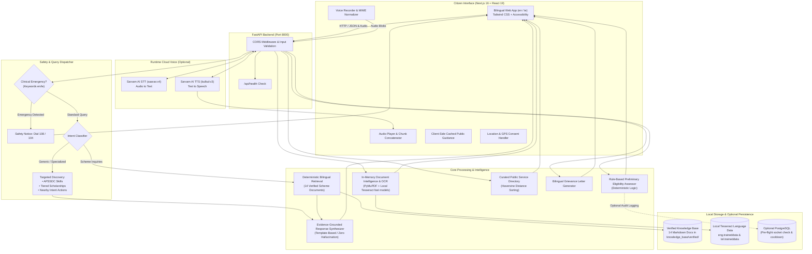

# AI Grama Sahayak

### Voice-First Intelligent Citizen Assistance for Rural India
**HackWithAditya 2026 | Level 1 Prototype | Andhra Pradesh First**

---

## Project Overview

In rural and semi-urban India, citizens frequently encounter substantial hurdles when trying to discover, understand, and apply for government welfare programs:
- **Fragmented Information:** Policy guidelines, eligibility criteria, and administrative processes are dispersed across disparate department portals and physical offices.
- **Language & Literacy Barriers:** Official administrative circulars are predominantly published in formal bureaucratic English or complex phrasing, creating barriers for native Telugu speakers and citizens with emerging literacy.
- **Documentation Complexity:** Understanding which identity, income, caste, or land records are required—and whether an existing certificate is valid—causes repeated visits to administrative offices.
- **Unreliable Connectivity:** Rural communities frequently face intermittent cellular coverage, leading to disrupted transactions and lost progress on standard web portals.

**AI Grama Sahayak** is an independent, voice-first citizen assistance platform designed to bridge these gaps for the citizens of Andhra Pradesh. It combines bilingual conversational guidance in **Telugu and English**, deterministic knowledge retrieval across 14 verified government schemes, in-memory document intelligence with local Optical Character Recognition (OCR), preliminary rule-based eligibility checks, nearby public service navigation, and bilingual grievance drafting.

> [!IMPORTANT]
> **Prototype Classification Notice:**<br>
> AI Grama Sahayak is an independent student-built prototype developed exclusively for the **HackWithAditya 2026 Hackathon**. It is **not** an official Government of Andhra Pradesh service, is not directly integrated with live government administrative databases, and does not provide legally binding eligibility determinations or official grievance submissions.

---

## Target Users

- **Rural and Semi-Urban Citizens:** Seeking accessible, voice-first explanations of public welfare programs.
- **Farmers & Agricultural Workers:** Inquiring about crop insurance (PMFBY), input support (Annadata Sukhibhava / PM-KISAN), soil health testing, and local Rythu Bharosa Kendram (RBK) services.
- **Senior Citizens & Vulnerable Households:** Seeking transparent information regarding NTR Bharosa pensions, disability benefits, and ration services.
- **Students & Families:** Inquiring about educational assistance, post-matric fee reimbursements (Vidya Deevena), boarding assistance (Vasathi Deevena), and APSSDC skill training.
- **Telugu-Speaking Communities:** Citizens who require accurate, culturally grounded conversational interaction in their mother tongue.
- **Citizens with Limited Digital Literacy or Constrained Connectivity:** Benefiting from simplified voice inputs, clean user interfaces, and offline-resilient public guidance.

---

## Key Features & Implementation Boundaries

| # | Feature | Implemented Capability | Implementation Boundary & Limitations |
| :---: | :--- | :--- | :--- |
| **1** | **Bilingual Citizen Assistance** | Conversational interaction in both English and Telugu across web and voice modalities. | Limited to English (`en`) and Telugu (`te`); does not support additional Indic languages. |
| **2** | **Scheme Knowledge Retrieval** | Deterministic domain retrieval across 14 verified welfare schemes in Andhra Pradesh. | Grounded strictly in the 14 verified markdown documents; queries outside these schemes yield honest unavailability notices. |
| **3** | **Domain-Specific Guidance** | Specialized query routing across Agriculture, Healthcare, Education, and Social Welfare. | Domain routing is rule- and keyword-guided; complex multi-domain queries are mapped to the primary identified domain. |
| **4** | **Speech-to-Text & Text-to-Speech** | Integration with Sarvam AI (`saaras:v4` STT, `bulbul:v3` TTS) for high-accuracy Indic voice interaction. | Requires an active `SARVAM_API_KEY` and internet access for cloud synthesis; falls back to text or browser TTS when unconfigured. |
| **5** | **Scholarship Discovery** | Typo-tolerant recognition for educational inquiries (e.g., `availble schoalrship`) with category breakdown. | Explains program structures and eligibility; does not guarantee active college admissions or budgetary disbursements. |
| **6** | **Preliminary Eligibility Checks** | Deterministic criteria evaluation (landholding, income, age, residency) for key welfare schemes. | Provides preliminary advisory checks only; official entitlement is determined solely by government authorities upon scrutiny. |
| **7** | **Digital PDF Document Parsing** | In-memory extraction of text and metadata from uploaded PDF certificates with resource limits. | Enforces a strict 20-page and 100,000-character safety limit; does not verify document cryptographic authenticity. |
| **8** | **Local English & Telugu Image OCR** | Embedded PyMuPDF OCR powered by local Tesseract traineddata (`eng` and `tel`) in `backend/app/services/documents/tessdata/`. | Runs completely locally in memory; OCR accuracy depends heavily on image clarity, resolution, and lighting. |
| **9** | **Multi-Format Document Handling** | Validates and processes PNG, JPEG, WebP, and scanned image-only PDFs using file magic bytes. | Maximum file upload size is bounded at 10 MB; corrupt or encrypted files are safely rejected. |
| **10** | **Sensitive Aadhaar Number Masking** | Automated regex-based redaction of 12-digit Aadhaar patterns to `XXXX-XXXX-1234` format. | Redacts displayed and logged numbers; does not connect to UIDAI for citizen identity verification. |
| **11** | **Curated Facility Discovery** | Location lookups for RBKs, Grama/Ward Secretariats, Primary/Community Health Centres, and Hospitals. | Uses a curated directory of public facilities in Andhra Pradesh; does not cover every local sub-centre or private clinic. |
| **12** | **Chat-to-Nearby Navigation** | Conversational detection of location intents triggering quick-action navigation cards. | Provides approximate straight-line Haversine distances; does not provide turn-by-turn road navigation. |
| **13** | **Bilingual Grievance Drafting** | Generates structured formal representation drafts in English and Telugu for administrative escalation. | Formats printable letters and submission instructions; does not transmit petitions directly to Spandana / MeeSeva. |
| **14** | **Low-Network Assistance** | Client-side cached public Q&As and local query drafting for disconnected environments. | Caches public guidance only; real-time voice synthesis and server-side OCR require active network connectivity. |
| **15** | **Emergency Safety Routing** | Immediate clinical safety interception for acute medical queries directing users to 108/104. | Intercepts clinical emergencies; does not provide medical triage, diagnostics, or clinical treatment advice. |
| **16** | **Responsive Bilingual UI** | Accessible Next.js interface with native Telugu font rendering, audio playback, and accessible contrast. | Web-browser based client; native mobile apps (Android/iOS) are not part of the Level 1 prototype. |

---

## System Architecture

The following diagram illustrates the component architecture, data flow, and runtime boundaries of the application:



---

## Technology Stack

| Layer | Technology | Version | Purpose in AI Grama Sahayak |
| :--- | :--- | :--- | :--- |
| **Frontend Framework** | Next.js (App Router) | 16.4.6 | Responsive, SSR/prerendered citizen interface |
| **UI Library** | React | 19.3.0 | Modern declarative UI components |
| **Styling** | Tailwind CSS / Turbopack | 4.3.3 | Accessible, responsive utility-first styling |
| **Frontend Language** | TypeScript | ^5.0.0 | Type safety across client components and services |
| **Backend Framework** | FastAPI | >=0.115.0 | High-performance asynchronous REST API gateway |
| **ASGI Server** | Uvicorn | >=0.30.0 | Asynchronous web server running backend application |
| **Data Validation** | Pydantic / Pydantic Settings | >=2.10.0 | Strict schema validation and environment management |
| **PDF & Text Extraction** | PyMuPDF (fitz) | >=1.24.0 | In-memory PDF text extraction and embedded OCR engine |
| **Image Processing** | Pillow (PIL) | >=10.0.0 | Image decoding, format normalization, and drawing |
| **PDF Fallback** | pypdf | >=4.0.0 | Secondary fallback text extraction for standard PDFs |
| **OCR Models** | Tesseract `tessdata_fast` | 2018 (Apache 2.0) | Bundled English & Telugu OCR models (`eng`, `tel`) |
| **HTTP Client** | HTTPX | >=0.28.0 | Asynchronous calls to external voice service APIs |
| **Database ORM** | SQLAlchemy / Psycopg / Asyncpg | >=2.0.30 | Optional persistence and pre-flight database auditing |
| **Speech Services** | Sarvam AI REST API | `saaras:v4` / `bulbul:v3` | Indic Speech-to-Text and Text-to-Speech integration |
| **Testing Framework** | Pytest / Pytest-Asyncio | >=8.3.0 | Automated unit, regression, and acceptance suites |

---

## Repository Structure

```
ai-grama-sahayak/
├── .env.example                               # Template for local environment configuration
├── .gitignore                                 # Git exclusion rules (ignores .env, .venv, node_modules)
├── README.md                                  # Primary repository overview and setup guide
├── backend/
│   ├── pytest.ini                             # Pytest configuration and test path definitions
│   ├── requirements.txt                       # Backend Python dependencies
│   ├── app/
│   │   ├── main.py                            # FastAPI entry point, CORS, routers & exception handlers
│   │   ├── api/                               # API route definitions
│   │   │   ├── chat.py                        # Conversational assistant & intent dispatching
│   │   │   ├── documents.py                   # Document analysis & OCR upload endpoint
│   │   │   ├── eligibility.py                 # Preliminary scheme eligibility assessment
│   │   │   ├── grievances.py                  # Bilingual grievance letter drafting
│   │   │   ├── services.py                    # Curated nearby facility discovery
│   │   │   └── voice.py                       # Sarvam AI speech transcription & synthesis
│   │   ├── core/                              # Core configuration, logging, exceptions & security
│   │   ├── database/                          # Database connection, pre-flight check & session manager
│   │   ├── schemas/                           # Pydantic input/output contract schemas
│   │   └── services/                          # Business logic engines
│   │       ├── answer_synthesizer.py          # Evidence-grounded response generator
│   │       ├── documents/                     # Document intelligence, field parsing & OCR
│   │       │   ├── analyzer.py                # Pipeline coordinating extraction & parsing
│   │       │   ├── extractor.py               # In-memory PDF & image text extraction
│   │       │   ├── field_parser.py            # Regex-based certificate field extraction
│   │       │   └── tessdata/                  # Bundled Tesseract fast language models
│   │       │       ├── NOTICE                 # Apache 2.0 attribution notice
│   │       │       ├── eng.traineddata        # English fast OCR model (~4.11 MB)
│   │       │       └── tel.traineddata        # Telugu fast OCR model (~2.77 MB)
│   │       ├── eligibility/                   # Deterministic scheme eligibility rules
│   │       ├── grievances/                    # Template-based bilingual grievance drafts
│   │       ├── retrieval/                     # Deterministic knowledge retrieval & evaluator
│   │       ├── services/                      # Facility directory & Haversine distance calculator
│   │       └── voice/                         # Speech transcription, synthesis & audio chunking
│   └── tests/                                 # Backend integration test suite (330 tests)
├── docs/                                      # Supplementary architecture & evaluation docs
│   ├── AI_DISCLOSURE.md                       # Comprehensive disclosure of AI tools & models
│   ├── ARCHITECTURE.md                        # Deep dive into system architecture & flows
│   ├── TESTING.md                             # Test execution reports and reproduction instructions
│   └── api_contracts.md                       # Formal OpenAPI schema specifications
├── document_samples/                          # Synthetic sample certificates for testing OCR
├── frontend/
│   ├── package.json                           # Next.js and frontend dependencies
│   ├── package-lock.json                      # Deterministic frontend dependency lockfile
│   └── src/
│       ├── app/                               # Next.js App Router root layout & main page
│       ├── components/                        # UI components (Chat, Voice, Docs, Services)
│       └── services/                          # Client API clients, voice utilities & caching
├── knowledge_base/
│   ├── evaluation_dataset.json                # 24-query retrieval quality benchmark dataset
│   ├── sources_manifest.csv                   # Provenance and source URLs for verified schemes
│   └── verified/                              # 14 verified bilingual scheme documents
│       ├── agriculture/                       # Annadata Sukhibhava, KCC, Crop Insurance, Soil Health
│       ├── education/                         # Samagra Shiksha, Thalliki Vandanam, Vidya/Vasathi Deevena
│       ├── healthcare/                        # 104/108 Emergency, Ayushman Bharat, Aarogyasri
│       └── schemes/                           # Sachivalayam, MGNREGS, NTR Bharosa, Housing
└── tests/                                     # Root integration and API endpoint regression suite (65 tests)
```

---

## Quick Start Guide (Windows PowerShell)

Follow these step-by-step instructions to clone, configure, and run the prototype on Windows:

### 1. Prerequisites
- **Git:** Git 2.30+ installed.
- **Python:** Python 3.11, 3.12, 3.13, or 3.14.
- **Node.js:** Node.js 18.x, 20.x, or 22.x with `npm`.

### 2. Clone and Checkout
```powershell
git clone <repository_url> ai-grama-sahayak
cd ai-grama-sahayak
git checkout integration/round1
```

### 3. Backend Setup
Create and activate a virtual environment, then install Python dependencies:
```powershell
python -m venv backend\.venv
.\backend\.venv\Scripts\Activate.ps1
python -m pip install --upgrade pip
pip install -r backend\requirements.txt
```

### 4. Environment Configuration
Copy the template configuration file:
```powershell
Copy-Item .env.example .env
```
Open `.env` in a text editor. The default settings allow immediate local development:
- **Sarvam AI Key:** If you have an API key, set `SARVAM_API_KEY=your_key_here`. If omitted, all text features, document OCR, scheme discovery, eligibility checks, and nearby lookups will still work normally.
- **PostgreSQL Database:** PostgreSQL is **completely optional**. If you do not have PostgreSQL running locally, set:
  ```ini
  DATABASE_ENABLED=false
  DATABASE_URL=disabled
  ```
  The backend will automatically detect this and run in zero-database mode without blocking or connection delays.

### 5. Launch Backend Server
From the repository root:
```powershell
.\backend\.venv\Scripts\python -m uvicorn app.main:app --app-dir backend --host 127.0.0.1 --port 8000 --reload
```
- **Backend API Health Check:** [http://127.0.0.1:8000/api/health](http://127.0.0.1:8000/api/health)
- **Interactive OpenAPI Docs:** [http://127.0.0.1:8000/docs](http://127.0.0.1:8000/docs)

### 6. Frontend Setup & Launch
Open a second PowerShell window, navigate to the `frontend/` directory, and install dependencies using the lockfile:
```powershell
cd frontend
npm ci
npm run dev
```
- **Citizen Application Interface:** [http://localhost:3000](http://localhost:3000)

---

## Local OCR & Document Intelligence Setup

The document intelligence engine in AI Grama Sahayak is engineered to operate **entirely locally in memory**, avoiding external OCR cloud API dependencies or transmitting sensitive documents to third-party endpoints.

### Key Capabilities & Boundaries:
- **Languages Supported:** English (`eng`) and Telugu (`tel`).
- **File Formats Supported:** Scanned PDFs, PNG, JPEG, and WebP images.
- **Execution Mechanism:** PyMuPDF (`fitz`) embedded Tesseract OCR engine dynamically accessing bundled language data located at `backend/app/services/documents/tessdata/`.
- **Resource Bounds:** Enforces strict limits: max 20 PDF pages, max 100,000 characters extracted, max 10 MB file upload limit.
- **Privacy Enforcement:** Extracts document text in-memory via `io.BytesIO`; sensitive 12-digit Aadhaar numbers are automatically masked to `XXXX-XXXX-1234`.
- **Accuracy Notice:** OCR accuracy depends on the quality, angle, lighting, and resolution of uploaded images. Low-contrast or blurred documents return an honest `unverified_or_incomplete` status.
- **Licensing & Attribution:** The bundled `eng.traineddata` and `tel.traineddata` files originate from `tesseract-ocr/tessdata_fast` and are distributed under the **Apache License 2.0**. Full attribution is maintained in [backend/app/services/documents/tessdata/NOTICE](file:///backend/app/services/documents/tessdata/NOTICE).

---

## API Reference

The backend exposes 8 RESTful API endpoints:

| Method | Endpoint | Description | Status |
| :---: | :--- | :--- | :---: |
| `GET` | `/api/health` | Service health status, system identifier, and API version. | Active |
| `POST` | `/api/chat` | Bilingual conversational guidance, scheme retrieval, and emergency routing. | Active |
| `POST` | `/api/eligibility/check` | Deterministic preliminary welfare scheme eligibility assessment. | Active |
| `POST` | `/api/voice/transcribe` | Transcribes spoken English and Telugu audio chunks via Sarvam AI. | Active (Optional Key) |
| `POST` | `/api/voice/speak` | Synthesizes Telugu and English text into natural speech audio via Sarvam AI. | Active (Optional Key) |
| `POST` | `/api/documents/analyze` | In-memory document text extraction, local OCR, and field parsing. | Active |
| `GET` | `/api/services/nearby` | Location-based discovery of RBKs, Secretariats, PHCs, and Hospitals. | Active |
| `POST` | `/api/grievances/draft` | Generates bilingual formal grievance representation letters. | Active |

---

## Testing and Evaluation

### Verified Test Suite Results (Phase 6C.2)

The repository maintains comprehensive automated regression coverage across both backend and frontend layers:

```
================ Consolidated Test Suite Metrics ================
Backend Integration Tests (backend/tests):       325 passed, 5 skipped
Root Regression Tests (tests):                    65 passed, 0 skipped
Frontend Voice Unit Tests (voiceUtils.test.mjs):  10 passed, 0 skipped
Frontend Privacy Tests (savedQuestions.test.mjs):  8 passed, 0 skipped
-----------------------------------------------------------------
Total Passing Automated Test Executions:         408 passed (0 failures)
=================================================================
```

> [!NOTE]
> The 19 physical acceptance tests in `backend/tests/test_physical_acceptance_phase6c.py` (covering typo tolerance, scholarship discovery, nearby intents, PNG/JPG/WebP/PDF OCR, and authentic Telugu character extraction) are executed within the `backend/tests` suite (325 passed) and are not counted twice.

### Static Analysis & Build Verification:
- **ESLint:** Passed with 0 errors and 0 warnings (`npm --prefix frontend run lint`).
- **Production Build:** Next.js production build succeeded with 0 errors (`npm --prefix frontend run build`). TypeScript compilation verified during build.

### Retrieval Quality Benchmark:
The retrieval system is benchmarked against `knowledge_base/evaluation_dataset.json` (24 queries across Agriculture, Healthcare, Education, and Welfare):
- **Total Benchmark Queries:** 24 (22 positive, 2 negative)
- **Hit Rate @ 1:** **100.0%** (22/22)
- **Hit Rate @ 3:** **100.0%** (22/22)
- **Mean Reciprocal Rank (MRR):** **1.000**
- **Negative Rejection Accuracy:** **100.0%** (2/2)
- **Cross-Domain Leakage Violations:** **0**

> [!IMPORTANT]
> **Evaluation Scope Notice:** These benchmark results reflect retrieval accuracy against the verified 24-query evaluation dataset. They validate the retrieval engine's boundary enforcement and do not guarantee universal answer accuracy across arbitrary real-world prompts.

For complete commands to reproduce all test suites, refer to [docs/TESTING.md](file:///docs/TESTING.md).

---

## Privacy and Safety Architecture

- **In-Memory Document Handling:** Uploaded citizen files are analyzed in temporary memory buffers and are never written to disk or logged.
- **Aadhaar Masking:** 12-digit Aadhaar patterns are automatically redacted to `XXXX-XXXX-1234` before any field is displayed in the UI or recorded in logs.
- **Clinical Emergency Interception:** Emergency health inquiries (e.g., chest pain, severe bleeding, poison ingestion) immediately trigger high-priority notices instructing users to call **108** or **104**, preventing conversational delay.
- **Explicit Location Consent:** Geographic coordinates are accessed only upon explicit user consent via the browser Geolocation API; users can alternatively select their district manually.
- **Privacy-Preserving Offline Caching:** Client-side local storage caches only generic public questions and official guidance; no personal identity details or uploaded documents are stored in browser cache.
- **Preliminary Advisory Only:** Eligibility checks and document parsing outputs are clearly labeled as non-binding preliminary guidance; the system explicitly avoids claiming official document authentication.
- **No Direct Administrative Filing:** Grievance drafts are provided to the citizen as printable text and structured letters; they are not submitted automatically to government portals without citizen review.

---

## Known Limitations

1. **Limited Scheme Scope:** Grounded in 14 verified welfare schemes in Andhra Pradesh; schemes outside this corpus return honest unverified notices.
2. **Dynamic Policy Updates:** Welfare criteria and budgetary amounts are governed by administrative Government Orders (G.O.s) that change periodically and require ongoing verification.
3. **Curated Facility Directory:** The facility directory contains curated government centres (RBKs, Secretariats, CHCs, Hospitals) and does not represent an exhaustive census of all state facilities.
4. **Approximate Distances:** Facility distances are calculated using the straight-line Haversine formula and do not reflect actual road driving distances or traffic conditions.
5. **OCR Sensitivity:** Local OCR performance is dependent on image resolution, orientation, and lighting; hand-written certificates or degraded scans may not extract cleanly.
6. **Language Support:** Implemented specifically for Telugu and English; does not support Hindi or other regional languages in Level 1.
7. **Cloud Voice Dependency:** High-quality Indic voice transcription and synthesis depend on the external Sarvam AI cloud service; degraded connectivity requires falling back to text.
8. **Low-Network Scope:** Offline capabilities provide pre-cached public guidance; real-time OCR and speech recognition cannot operate fully offline.
9. **Preliminary Advisory Status:** Eligibility assessments evaluate user-declared criteria and do not verify bank linkages, e-KYC status, or field verification reports.
10. **No Document Authentication:** The platform reads text from certificates but cannot detect forged documents, altered stamps, or invalid digital signatures.
11. **No Direct Government Submission:** The system cannot submit applications directly into government workflow systems (e.g., Navasakam, MeeSeva, Spandana).

---

## Team Contributions

| Member | Name | Primary Responsibilities & Contributions |
| :---: | :--- | :--- |
| **Member 1** | **Anand** | AI query routing, backend application architecture, evidence-grounded answer synthesis, clinical emergency safety interception, Sarvam voice service integration, and consolidated integration coordination. |
| **Member 2** | **Durga Naik** | Bilingual knowledge base development (14 verified scheme documents), deterministic retrieval engineering, source manifest curation, and retrieval benchmark dataset evaluation. |
| **Member 3** | **Yogitha** | Frontend Next.js development, responsive bilingual UI (en/te), voice recorder/player integration, and client-side low-network guidance caching. |
| **Member 4** | **Radha** | Document intelligence pipeline, in-memory local OCR integration, preliminary scheme eligibility rule engine, nearby facility service directory, and related test development. |

*Note: Final integration corrections, safety audits, and cross-platform regressions were coordinated collaboratively under Member 1 lead integration.*

---

## AI Tools & External Dependency Disclosure

In adherence to HackWithAditya 2026 guidelines, we fully disclose the AI tools and external dependencies utilized:

- **Antigravity (Google DeepMind):** Used as an agentic AI coding and testing assistant for automated test orchestration, debugging, and multi-file code integration.
- **ChatGPT (OpenAI):** Used during initial architectural planning, API contract drafting, design brainstorming, and documentation review.
- **Sarvam AI APIs:** Utilized as an external cloud speech service at runtime (`saaras:v4` for speech-to-text, `bulbul:v3` with speaker `kavitha` for text-to-speech).
- **Tesseract OCR Language Data:** Bundled fast models (`eng.traineddata`, `tel.traineddata`) from the open-source `tesseract-ocr/tessdata_fast` project (Apache License 2.0).
- **Core Open Source Libraries:** FastAPI, Next.js, React, PyMuPDF (fitz), Pillow, Pydantic, Tailwind CSS, Uvicorn, and Pytest.

For full disclosure details, see [docs/AI_DISCLOSURE.md](file:///docs/AI_DISCLOSURE.md).

---

## Proposed Level 2 Enhancements (48-Hour Roadmap)

While Level 1 focuses on core functionality, safety, and bilingual reliability, the following enhancements are identified for Level 2:
1. **Expanded Scheme Corpus:** Ingesting 25+ additional state and central welfare schemes with automated source diff tracking.
2. **Interactive Citizen Action Plans:** Step-by-step interactive checklists guiding citizens through physical Secretariat and MeeSeva visits.
3. **Advanced OCR Confidence Scoring:** Providing word-level confidence metrics and guiding users to re-take blurred photos.
4. **Expanded Public Service Geo-Directory:** Incorporating mandal-wide facility datasets with landmark references and transit tips.
5. **Enhanced Offline Service Worker:** Comprehensive progressive web app (PWA) offline caching for full offline scheme browsing.

---

## Disclaimer

**AI Grama Sahayak** is an experimental educational prototype developed for the HackWithAditya 2026 hackathon. It provides informational guidance and preliminary assistance to help rural citizens navigate public services. It is **not** an official government agency portal, does not make authoritative entitlement determinations, does not dispense clinical medical advice, and is not legally binding. Citizens should verify critical policy information with their local Grama / Ward Sachivalayam or official government portals.
