# AI Grama Sahayak — System Architecture Deep Dive

This document details the architectural design and component interactions of the AI Grama Sahayak Level 1 prototype.

---

## 1. High-Level Architectural Flow

The platform is designed around deterministic safety, bounded response latency, and verifiable domain retrieval. The architecture separates citizen interaction channels from internal reasoning and processing pipelines.

```mermaid
flowchart TD
    subgraph Client["Citizen Interface (Next.js 16 + React 19)"]
        UI["Bilingual Web Interface (en / te)"]
        AudioRec["Audio Recorder & MIME Normalizer"]
        AudioPlay["Audio Player (Base64 Chunk Stitching)"]
        OfflineStore["Client-side Public Q&A Storage"]
        GPSModule["Location / GPS Consent Module"]
    end

    subgraph BackendGateway["FastAPI Application Gateway (Port 8000)"]
        CORS["CORS & Request Validation Middleware"]
        HealthEndpoint["/api/health System Check"]
        ErrorHandlers["Standardized JSON Error Handlers"]
    end

    subgraph SafetyAndRouting["Safety, Emergency & Intent Routing"]
        EmergencyCheck{"Clinical Emergency?\n(108 / 104)"}
        IntentRouter{"Intent Classification"}
        APSSDCRoute["APSSDC Skill Guidance"]
        ScholarshipRoute["Tiered Scholarship Discovery"]
        NearbyDetect["Nearby Facility Navigation Action"]
    end

    subgraph CoreServices["Processing & Intelligence Engines"]
        Retrieval["Deterministic Bilingual Retrieval\n(14 Verified Scheme Documents)"]
        Synthesizer["Evidence-Grounded Response Synthesizer\n(Template-Based / No LLM Hallucination)"]
        Eligibility["Rule-Based Preliminary Eligibility Assessor\n(Criteria Evaluation)"]
        DocEngine["In-Memory Document Intelligence\n(PyMuPDF + Local Tesseract OCR)"]
        NearbyDirectory["Curated Public Service Directory\n(Haversine Distance Sorting)"]
        GrievanceGen["Bilingual Grievance Draft Generator"]
    end

    subgraph SpeechIntegration["External Speech Services (Optional)"]
        SarvamSTT["Sarvam AI Speech-to-Text\n(saaras:v4)"]
        SarvamTTS["Sarvam AI Text-to-Speech\n(bulbul:v3)"]
    end

    subgraph DataStorage["Persistence & Local Models"]
        KnowledgeBase[("14 Verified Scheme Documents\nMarkdown in knowledge_base/verified/")]
        TessData[("Local Tesseract Language Data\neng.traineddata & tel.traineddata")]
        PostgresDB[("Optional PostgreSQL Database\n(Auditing & Logging)")]
    end

    UI <-->|"HTTP / JSON & Audio"| CORS
    AudioRec -->|"Base64 / Audio Blob"| CORS
    CORS --> HealthEndpoint
    CORS --> ErrorHandlers
    CORS --> EmergencyCheck

    EmergencyCheck -->|"Emergency Detected"| UI
    EmergencyCheck -->|"Standard Query"| IntentRouter

    IntentRouter -->|"APSSDC Match"| APSSDCRoute
    IntentRouter -->|"Scholarship Match"| ScholarshipRoute
    IntentRouter -->|"Nearby Intent Match"| NearbyDetect
    IntentRouter -->|"Scheme / Domain Query"| Retrieval

    Retrieval --> KnowledgeBase
    Retrieval --> Synthesizer
    APSSDCRoute --> Synthesizer
    ScholarshipRoute --> Synthesizer
    NearbyDetect --> Synthesizer

    CORS --> Eligibility
    CORS --> DocEngine
    CORS --> NearbyDirectory
    CORS --> GrievanceGen
    CORS --> SarvamSTT
    CORS --> SarvamTTS

    DocEngine --> TessData
    Eligibility -.->|"Optional Audit"| PostgresDB

    Synthesizer --> UI
    DocEngine --> UI
    NearbyDirectory --> UI
    GrievanceGen --> UI
    SarvamTTS --> AudioPlay
```

---

## 2. Core Subsystems and Design Decisions

### 2.1 Deterministic Query Routing & Safety Interception
- **Emergency Interception:** The chat pipeline checks incoming citizen messages against clinical emergency keywords (in both English and Telugu). If an acute medical condition or emergency is detected, it intercepts the request and issues an emergency safety notice directing the citizen to dial **108** (emergency ambulance) or **104** (health information advice).
- **Rule-Based Routing:** Generic queries (e.g., skill development, broad category scholarships) are handled via targeted pattern matching and deterministic guidance templates rather than open-ended text generators, preventing hallucinations.

### 2.2 Knowledge Retrieval Engine
- **Corpus:** 14 verified bilingual markdown files residing in `knowledge_base/verified/`.
- **Chunking:** Chunked with bounded token limits and domain tags.
- **Search:** Keyword and semantic similarity scoring with strict domain scoping (agriculture, healthcare, education, welfare schemes).
- **Domain Guard:** Cross-domain leakage checks ensure that agricultural queries do not retrieve pension guidelines, and vice-versa.

### 2.3 Response Synthesis Architecture
- **Zero Hallucination:** Answers are synthesized directly from retrieved verified text chunks and structured scheme profiles.
- **Bilingual Consistency:** Responses match the citizen's requested language (`en` or `te`). If Telugu is requested, all section headers, application steps, and disclaimers are rendered in natural Telugu.
- **Factual Safety:** Quantitative figures (e.g., pension amounts, scholarship disbursements) are strictly qualified against applicable Government Orders (G.O.s) rather than presenting historical figures as unconditional guarantees.

### 2.4 Document Intelligence Pipeline
- **In-Memory Operation:** Files uploaded to `/api/documents/analyze` are processed entirely in memory via `io.BytesIO`. No raw citizen documents are written to persistent disk storage.
- **Resource Constraints:** Enforces strict limits: max 20 PDF pages, max 100,000 extracted characters, max 10MB file size.
- **OCR Engine:** Uses PyMuPDF's embedded OCR interface with local bundled Tesseract models (`eng.traineddata` and `tel.traineddata`) located in `backend/app/services/documents/tessdata/`.
- **Privacy Masking:** Automatically detects and redacts 12-digit Aadhaar numbers, converting them to `XXXX-XXXX-1234` format.

### 2.5 Resilient Voice Architecture
- **Decoupled Fallback:** The backend delegates speech recognition and synthesis to Sarvam AI (`saaras:v4` STT, `bulbul:v3` TTS).
- **Timeout Management:** Backend operations enforce bounded per-request timeouts with graceful degradation to browser speech synthesis if backend voice services are unconfigured or unavailable.
- **Format Normalization:** Speech synthesis produces valid PCM WAV chunks that are verified for frame count and audio consistency before delivery.

### 2.6 Optional Database Integration
- **PostgreSQL Decoupling:** The backend includes a non-blocking TCP socket check (`is_host_reachable`) with a 30-second backoff cooldown.
- **Zero-Dependency Operation:** If PostgreSQL is offline, unconfigured, or explicitly disabled (`DATABASE_ENABLED=false`), all citizen-facing endpoints remain fully functional.
